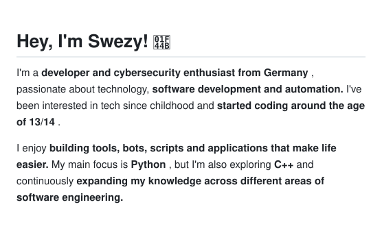
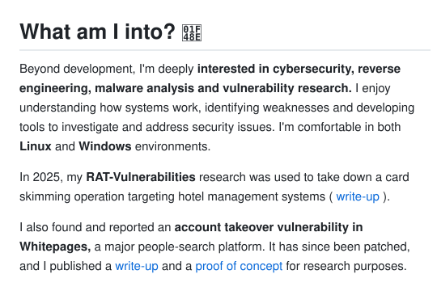
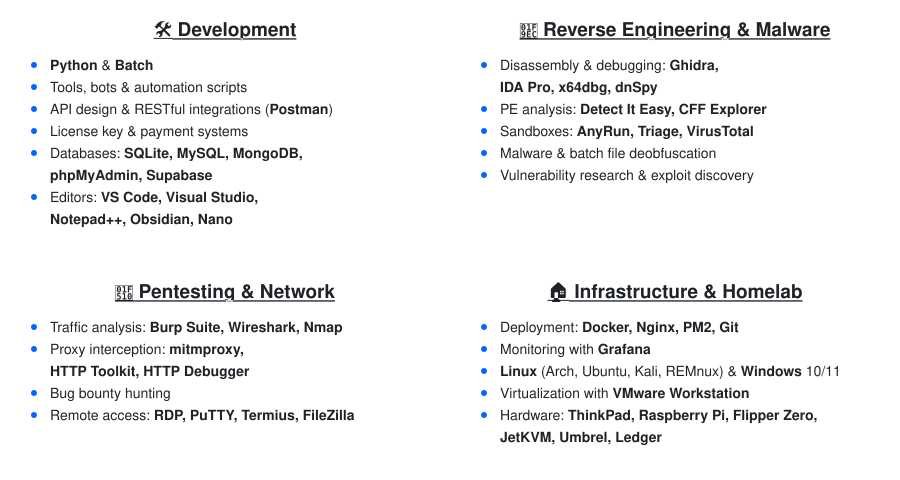

<code>Swezy@GitHub:~$ cat README.md</code>

  
  <a href="#about-me">About</a> •
  <a href="#what-i-do">What I Do</a> •
  <a href="#communities">Communities</a> •
  <a href="#contact">Contact</a>

  
  
  
  

  
  
  
  
  

 

 

 

  &nbsp;&nbsp;&nbsp;&nbsp;&nbsp;
  <a href="https://swezy.dev/blog/turkish-card-skimmer-takedown">Card Skimmer Takedown write-up</a> •
  <a href="https://swezy.dev/blog/whitepages-account-takeover">Whitepages write-up</a> •
  <a href="https://github.com/SwezyDev/Whitepages-PoC">Whitepages PoC</a>

  
> [!NOTE]
> I've always been <b>curious</b> about how things work <b>under the hood</b>. That curiosity is
> what pulled me into <b>cybersecurity</b>. Every system has a <b>weak spot</b>, and finding it
> is like <b>solving a puzzle</b>. I spend a lot of my <b>free time</b> digging into software,
> testing ideas and <b>building small tools</b> along the way. Some of them are <b>useful</b>,
> some are just <b>for fun</b>, but I <b>learn something new</b> from every one of them.

---

  
  
  
  

---

<h3 align="center">🤝 Communities</h3>

  
  
  

---

<h3 align="center">🔗 Wanna Chat?</h3>

  
  
  
  
   
  <a href="https://nohello.net">Don't just say hello — nohello.net</a>

---

    
  <i>"See the Network with other Perspectives."</i>
    
  

  

